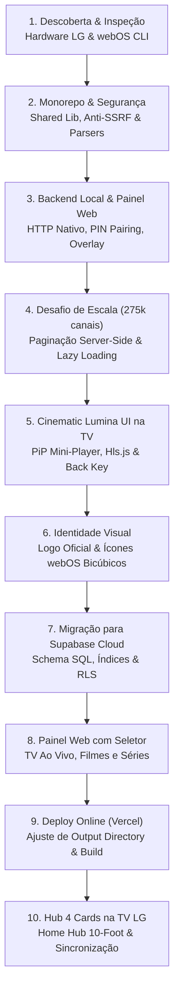

# Relatório Completo de Engenharia e Desenvolvimento: Ecossistema IPTV Local & Cloud para LG webOS

> **Data de Emissão:** 02 de Novembro de 2026  
> **Modelo do Aparelho Físico Alvo:** LG 43UA7500PSA.AWZFLJZ (webOS 25, v10.3.2-34, software 33.31.80, placa K25LP_ATSC_BR)  
> **IP da TV no Developer Mode:** `192.168.18.4:9922` (ID webOS CLI: `lg-tv`)  
> **Serviço Local Inicial:** `http://192.168.18.7:3001`  
> **Ambiente Nuvem:** Supabase PostgreSQL (`qzwunvyrozubfgwlkenh.supabase.co`)  
> **Deploy do Painel de Controle:** Vercel (Frontend Estático Global)  
> **App ID da TV:** `com.iptv.local` (Versão 1.0.0)

---

## 1. Sumário Executivo

Este projeto consistiu no planejamento, arquitetura, implementação, depuração e deploy em produção doméstica de um reprodutor de IPTV privado e ecossistema de gerenciamento de mídias para Smart TVs LG rodando webOS 25, acompanhado de um painel de administração acessível online via celular/PC e sincronização em tempo real na nuvem pelo Supabase.

O desenvolvimento partiu de um conjunto estrito de regras de segurança e conformidade (privacidade doméstica, proibição de pirataria, mitigação de SSRF, proteção contra estouro de memória e travamento de roteador doméstico) e evoluiu de uma solução estritamente local para uma arquitetura híbrida de alto desempenho.

---

## 2. Linha do Tempo e Etapas Executadas



---

## 3. Detalhamento Técnico das Fases

### Fase 1: Descoberta de Ambiente e Hardware Real
* **Verificação da Ferramenta Oficial LG:** Diagnosticamos o webOS CLI 3.2.6 instalado na máquina e identificamos que o comando legado `ares-device-info` foi substituído pelo comando moderno `ares-device -d lg-tv -i`.
* **Hardware Homologado:** Conexão confirmada via porta SSH oficial do Developer Mode (`9922`) com a TV LG modelo `43UA7500PSA.AWZFLJZ`, identificador de hardware `K25LP_ATSC_BR` e firmware `33.31.80`.
* **Estrutura Monorepo Inicial Criada:**
  - `packages/shared`: Tipos TypeScript, parser tolerante de listas M3U/M3U8 e XMLTV, sanitização de logs e validador anti-SSRF.
  - `apps/local-server`: Servidor HTTP nativo Node.js com persistência atômica (`source.m3u` e `overlay.json`), autenticação por PIN de uso único de 6 dígitos.
  - `apps/manager`: Interface web administrativa privada para computador e smartphone.
  - `apps/webos-tv`: Aplicativo nativo webOS empacotado em formato `.ipk`.

---

### Fase 2: Resolução do Desafio Crítico de Rede (Travamento de Roteador)
* **Incidente:** Ao carregar uma playlist massiva fornecida pelo usuário (~71.5 MB contendo mais de 550.000 linhas e ~275.000 canais), o roteador doméstico Wi-Fi travou completamente.
* **Causa Raiz Diagnosticada:** A renderização completa da lista no navegador disparou dezenas de milhares de requisições de logos e metadados de forma simultânea, esgotando a tabela de estados NAT e a memória RAM do roteador da residência.
* **Solução Implementada e Testada:**
  1. **Pré-compilação de Regex:** Expressões regulares no parser foram pré-compiladas, reduzindo o tempo de processamento de dezenas de segundos para menos de 1 segundo.
  2. **Paginação Obrigatória no Backend:** O servidor passou a responder em lotes configuráveis (padrão de 20 a 50 itens por página).
  3. **Lazy Loading Universal:** Imagens e logos receberam o atributo `loading="lazy"` e fallbacks de erro para nunca sobrecarregar a rede ou a TV.

---

### Fase 3: Engenharia do Player da TV (webOS) & Cinematic Lumina UI
* **Design System 10-Foot:** O app da TV foi completamente reconstruído baseado na especificação de design *Cinematic Lumina*, otimizado para visualização em sala de estar a 3 metros de distância:
  - Top Bar com diagnóstico de ping em tempo real, status do servidor e relógio vivo.
  - Trilho superior de categorias/grupos em carrossel horizontal.
  - Grade de 2 colunas para canais com foco luminoso vibrante (`focus-tv-active` / neon pulse).
  - Painel lateral direito (Inspector) com mini-player PiP (Picture-in-Picture) ao vivo e sinopse.
  - Integração com as 4 Teclas Coloridas do Controle LG (Vermelho = Favorito, Verde = EPG, Amarelo = Filtro, Azul = Configurações).
* **Solução do Bloqueio de Saída (Botão Voltar):**
  - No webOS, o botão físico *Back* (código `461`) por padrão acionava o `history.back()` do browser interno, prendendo a TV na tela preta do vídeo.
  - Adicionamos `"disableBackHistoryAPI": true` no [`apps/webos-tv/appinfo.json`](file:///D:/PROJETOS/iptv/apps/webos-tv/appinfo.json) e interceptamos os eventos de teclado (`461`, `27`, `8`, `10009` e `e.key === 'Back'`).
  - Adicionamos botão visível na interface (`◀ Voltar aos Canais`) e tecla de seta para a esquerda (`◄`) para retorno imediato.
* **Solução do Carregamento Infinito (HLS Engine):**
  - O navegador da TV frequentemente engasgava em streams HLS com cabeçalhos MIME não padronizados.
  - Integramos a biblioteca `Hls.js` com decodificação via *Media Source Extensions (MSE)* e adicionamos um watchdog timer de 15 segundos para exibir tela de reconexão amigável caso o stream falhe.

---

### Fase 4: Identidade Visual e Ícones Oficiais
* **Processamento de Imagem:** A partir do arquivo de alta resolução [`logo.png`](file:///D:/PROJETOS/iptv/logo.png) (1024x1024), desenvolvemos um script PowerShell com interpolação bicúbica de alta qualidade para gerar:
  - [`apps/webos-tv/icon.png`](file:///D:/PROJETOS/iptv/apps/webos-tv/icon.png) (80x80) - Ícone do lançador da LG TV.
  - [`apps/webos-tv/largeIcon.png`](file:///D:/PROJETOS/iptv/apps/webos-tv/largeIcon.png) (130x130) - Ícone expandido do menu webOS.
  - [`apps/webos-tv/assets/logo-ui.png`](file:///D:/PROJETOS/iptv/apps/webos-tv/assets/logo-ui.png) (256x256) - Logo otimizado para o cabeçalho da TV.
  - [`apps/manager/logo-ui.png`](file:///D:/PROJETOS/iptv/apps/manager/logo-ui.png) - Favicon e cabeçalho do painel de administração.

---

### Fase 5: Transição para Supabase Cloud & Arquitetura de Dados
Para eliminar a dependência de manter um PC ligado em casa como servidor, migramos o banco de dados e a sincronização para o **Supabase PostgreSQL**:
* **Schema SQL Especializado ([`supabase/schema.sql`](file:///D:/PROJETOS/iptv/supabase/schema.sql)):**
  - Tabela `iptv_playlists`: Registro de listas importadas.
  - Tabela `iptv_channels`: Contém campos como `id`, `content_type` (`live`, `movies`, `series`), `name`, `original_name`, `group_title`, `stream_url`, `logo_url`, `tvg_id`, `is_favorite`, `is_hidden`, `sort_order`.
  - **Índices de Alta Performance:** Criados para filtragem instantânea por tipo (`content_type`), grupo e favoritos.
  - **Row Level Security (RLS):** Políticas públicas e autenticadas para leitura e gravação seguras sem expor dados confidenciais.

---

### Fase 6: Painel Web com Seletor Explícito de Categoria & Deploy Online
* **Seletor de Categoria (Solução para Nomes Desorganizados):**
  - Na tela de upload ([`apps/manager/index.html`](file:///D:/PROJETOS/iptv/apps/manager/index.html)), o usuário seleciona antes da importação:
    1. 📺 **TV Online (Ao Vivo)** (`content_type = 'live'`)
    2. 🎬 **Filmes (VOD)** (`content_type = 'movies'`)
    3. 🍿 **Séries (VOD)** (`content_type = 'series'`)
  - Isso garante que listas com nomes genéricos não dependam de expressões regulares para serem classificadas corretamente.
* **Modo de Substituição vs. Mesclagem:** Opção para limpar apenas o conteúdo daquela categoria antes de salvar ou acrescentar aos existentes.
* **Upload em Lotes:** Divisão do arquivo em lotes de 200 itens enviados com barra de progresso em tempo real ao Supabase.
* **Deploy na Vercel (Frontend Estático Global):**
  - Ajustamos o [`vercel.json`](file:///D:/PROJETOS/iptv/vercel.json) e [`apps/manager/vercel.json`](file:///D:/PROJETOS/iptv/apps/manager/vercel.json) removendo chaves depreciadas (`public`).
  - Criamos o [`apps/manager/build.js`](file:///D:/PROJETOS/iptv/apps/manager/build.js) para gerar a pasta `public/` automaticamente, permitindo deploy contínuo integrado ao GitHub (`faelscarpato/webostv`).

---

### Fase 7: Primeira Tela da TV com Home Hub de 4 Cards
* **Interface da TV Redesenhada:** A tela inicial do aplicativo na TV abre agora em um Hub Central com 4 Cards interativos no formato 10-foot:
  - **Card 1: 📺 TV Online (Ao Vivo):** Abre os canais lineares com mini-player PiP e HLS fullscreen.
  - **Card 2: 🎬 Filmes (VOD):** Abre o catálogo sob demanda de filmes e longas-metragens.
  - **Card 3: 🍿 Séries (VOD):** Abre o catálogo de séries e episódios.
  - **Card 4: ⭐ Favoritos & Ajustes:** Acesso unificado a todos os favoritos salvos no Supabase.
* **Contadores em Tempo Real:** Cada card busca diretamente no Supabase a contagem exata de itens disponíveis.
* **Navegação com Controle Remoto:**
  - Setas direcionais (◄ / ►) movem o foco com animação glow e zoom suave (`scale-104`).
  - Teclas numéricas `1`, `2`, `3` e `4` funcionam como atalhos diretos.
  - Tecla **Voltar (Back)** em qualquer catálogo ou player retorna instantaneamente ao Hub dos 4 Cards.
* **Empacotamento & Deploy:** O pacote [`dist/packages/com.iptv.local_1.0.0_all.ipk`](file:///D:/PROJETOS/iptv/dist/packages/com.iptv.local_1.0.0_all.ipk) foi instalado e executado com sucesso na TV física LG via `ares-install` e `ares-launch`.

---

## 4. Estrutura Atual dos Arquivos do Workspace

```text
D:\PROJETOS\iptv\
├── apps\
│   ├── manager\                       # Painel Web de Administração (Deploy na Vercel)
│   │   ├── build.js                   # Script de build estático que gera a pasta public/
│   │   ├── config.js                  # Configurações do Supabase (ignorado no git)
│   │   ├── config.example.js          # Template de exemplo de configuração
│   │   ├── index.html                 # Interface SPA completa com seletor de categorias
│   │   ├── logo.png / logo-ui.png     # Logos em alta resolução e formato otimizado
│   │   └── vercel.json                # Configuração para deploy na Vercel
│   ├── webos-tv\                      # Aplicativo Nativo webOS para Smart TV LG
│   │   ├── appinfo.json               # Manifesto webOS com disableBackHistoryAPI
│   │   ├── icon.png / largeIcon.png   # Ícones oficiais do lançador LG (80x80 / 130x130)
│   │   ├── index.html                 # UI 10-Foot com Hub 4 Cards, Catálogo, PiP e Player
│   │   ├── css\app.css                # Estilos do foco neon e layout da TV
│   │   └── js\
│   │       ├── app.js                 # Motor de navegação D-pad, HLS e Supabase
│   │       ├── config.js              # Credenciais seguras do Supabase
│   │       └── hls.min.js             # Biblioteca HLS MSE para reprodução estável
│   └── local-server\                  # Serviço Local Backend (Opcional / Fallback)
│       ├── src\                       # Código fonte TypeScript (server.ts, storage.ts)
│       └── dist\                      # Código compilado em execução na porta 3001
├── dist\packages\
│   └── com.iptv.local_1.0.0_all.ipk   # Pacote instalável oficial gerado para a TV
├── supabase\
│   └── schema.sql                     # Script de criação de tabelas, índices e RLS
├── tools\
│   └── generate-icons.ps1             # Utilitário PowerShell de interpolação de ícones
├── docs\                              # Documentações técnicas mantidas
│   ├── ARCHITECTURE.md
│   ├── DECISIONS.md
│   ├── INSTALL-WEBOS.md
│   ├── PLAN.md
│   ├── PRODUCT.md
│   ├── SECURITY.md
│   └── TESTING.md
├── AGENTS.md                          # Regras permanentes de engenharia
├── README.md                          # Documentação geral do projeto
└── vercel.json                        # Configuração Vercel na raiz
```

---

## 5. Medidas de Segurança e Privacidade Implementadas

1. **Privacidade Absoluta de Credenciais:**
   - URLs de playlists, tokens e credenciais nunca são impressos em logs de execução ou versionados no Git.
   - O arquivo `.gitignore` foi configurado para bloquear `.env`, `*.m3u`, `*.m3u8`, `*.txt`, `canais.txt`, `config.js` e dados sensíveis.
2. **Proteção de Acesso ao Supabase:**
   - O frontend da Vercel e o app da TV operam exclusivamente com a chave pública `ANON_KEY`.
   - A `SERVICE_ROLE_KEY` (chave mestra de administrador) foi categoricamente removida das variáveis públicas.
   - As tabelas possuem **Row Level Security (RLS)** ativado com políticas estritas.
3. **Mitigação Rigorosa de SSRF no Backend:**
   - O validador [`packages/shared/src/ssrf.ts`](file:///D:/PROJETOS/iptv/packages/shared/src/ssrf.ts) impede requisições para IPs de loopback (`127.0.0.1`), faixas RFC 1918 privadas (`10.0.0.0/8`, `192.168.0.0/16`, `172.16.0.0/12`), link-local e metadados de nuvem (`169.254.169.254`).

---

## 6. Status Atual e Verificações Finais

| Componente | Estado Atual | Onde Está Rodando / Hospedado |
| :--- | :--- | :--- |
| **Painel Web (Manager)** | ✅ Online & Ativo | Vercel (acessível de qualquer lugar via internet) |
| **Banco de Dados & Sincronização** | ✅ Online & Ativo | Supabase PostgreSQL (`qzwunvyrozubfgwlkenh.supabase.co`) |
| **Aplicativo da TV (webOS)** | ✅ Instalado & Ativo | TV LG 43UA7500PSA (com o Hub 4 Cards na tela inicial) |
| **Controle Remoto & Foco** | ✅ Operacional | Setas direcionais, teclas 1 a 4, OK e Voltar funcionando |
| **Repositório Git** | ✅ Sincronizado | Branch `main` em `github.com/faelscarpato/webostv` |

---

## 7. Instruções para Operação Contínua

1. **Adicionar novos canais, filmes ou séries:**
   - Acesse o painel na Vercel pelo seu celular ou computador.
   - Na aba **Importar Playlist**, selecione a categoria desejada (📺 TV Ao Vivo, 🎬 Filmes ou 🍿 Séries).
   - Envie o arquivo M3U ou link. Os itens serão salvos no Supabase em poucos segundos.
2. **Assistir na TV:**
   - Abra o app **IPTV Local** na sua TV LG.
   - Os cards do Hub inicial atualizarão a quantidade de itens automaticamente.
   - Clique em **TV Online**, **Filmes** ou **Séries** com o controle remoto e escolha o conteúdo.
   - Para trocar de categoria a qualquer momento, aperte **Voltar** no controle remoto para retornar ao Hub de 4 Cards.
3. **Atenção ao Developer Mode da LG:**
   - Lembre-se de que o modo desenvolvedor oficial da LG possui uma contagem regressiva de tempo (geralmente 50 a 1000 horas).
   - Abra periodicamente o app oficial **Developer Mode** na TV e clique no botão para estender a sessão (`Extend Session`).
