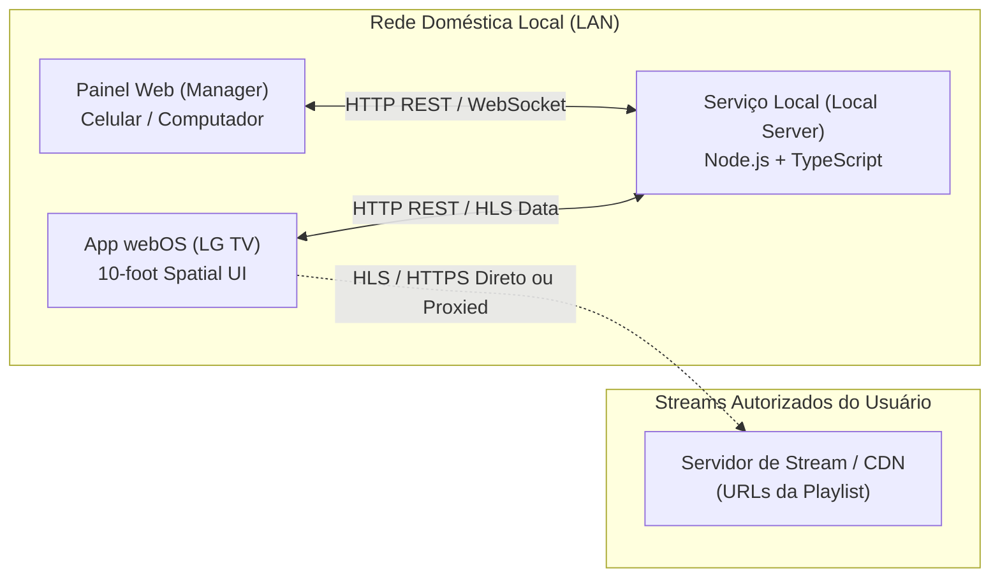
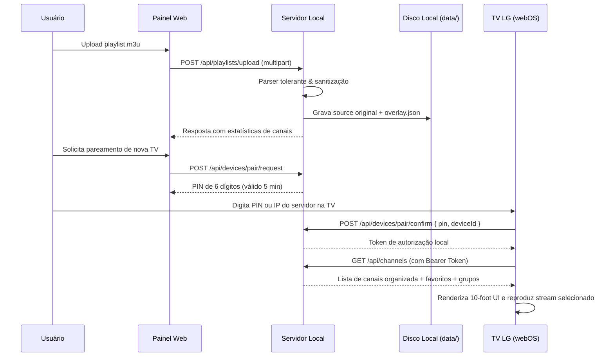

# Arquitetura do Sistema - IPTV Local

## 1. Visão Geral dos Componentes

O ecossistema é projetado como um monorepo modular contendo três aplicações principais e um pacote compartilhado:

---

## 2. Componentes

### 2.1 `packages/shared`
Contém tipagens TypeScript, schemas de validação Zod e utilitários agnósticos:
- Schema de Canal, Categoria, Playlist, Metadados EPG e Pareamento.
- Parser de M3U tolerante a falhas (linhas em branco, comentários, atributos com/sem aspas).
- Parser de XMLTV para mapear programações (`<programme start stop channel>`).

### 2.2 `apps/local-server` (Backend)
- **Runtime:** Node.js 24 + TypeScript (usando Fastify ou Express leve).
- **Armazenamento:** Arquivos locais estruturados em `data/` com escrita atômica (salvamento seguro contra corrupção em caso de queda de energia) e arquivos de banco leve/JSON versionados.
- **Módulo de Pareamento:** Gera e valida PINs temporários (6 dígitos, validade de 5 minutos, limite de 3 tentativas). Armazena tokens de TV autorizados com identificador de dispositivo.
- **Módulo Anti-SSRF:** Validador de URLs para importação de M3U remoto:
  - Resolução de DNS prévia.
  - Bloqueio estrito de `127.0.0.0/8`, `10.0.0.0/8`, `172.16.0.0/12`, `192.168.0.0/16`, `169.254.0.0/16`, IPv6 loopback (`::1`), multicast e link-local.
  - Validação em tempo de execução de cada redirecionamento HTTP (impedindo DNS rebinding).
- **Sanitizador de Logs:** Middleware interceptor que remove parâmetros sensíveis (como `token=`, `user=`, `password=`) antes de qualquer saída em stdout/logs.

### 2.3 `apps/manager` (Painel Web)
- **Stack:** Vite + React + Tailwind CSS.
- **Responsividade:** Otimizado tanto para telas de smartphone quanto desktop.
- **Funcionalidades:**
  - Upload de arquivos `.m3u` / `.m3u8` com feedback de parsing e contagem de canais.
  - Gerenciamento de Canais: ordenação por drag/botões, ocultar canal/grupo, renomear canais, marcar como favorito.
  - Tela de Pareamento com a TV: geração de PIN, lista de TVs conectadas e botão de revogação imediata de acesso.
  - Associação de EPG: upload de arquivo XMLTV e mapeamento canal ↔ ID de programação.

### 2.4 `apps/webos-tv` (App para webOS)
- **Tecnologia:** HTML5 + Vanilla TypeScript / CSS modular, sem frameworks pesados de frontend para máxima velocidade no processador ARM da TV.
- **Spatial Navigation:** Algoritmo de navegação direcional por coordenadas e foco CSS visível com alto contraste (borda amarela/azul luminosa, escala e sombra).
- **Mapeamento de Teclas do Controle:**
  - Códigos webOS para D-Pad: `38` (Up), `40` (Down), `37` (Left), `39` (Right), `13` (Enter/OK).
  - Teclas especiais: `461` (Back / Return no webOS), `415` (Play), `19` (Pause), `413` (Stop), `33` / `34` (PageUp / PageDown para Ch+ / Ch-).
- **Player de Vídeo:**
  - `<video id="player">` nativo com HLS suportado nativamente pelo webOS 25.
  - Tratamento de eventos de mídia (`waiting`, `playing`, `error`, `stalled`) com feedback visual claro (spinner de carregamento, mensagem explicativa de canal indisponível).

---

## 3. Fluxo de Dados e Armazenamento

