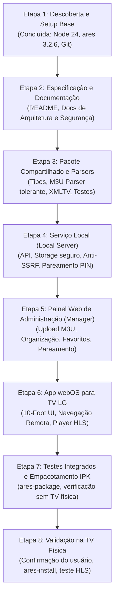

# Plano de Implementação e Critérios de Aceite - IPTV Local

## 1. Etapas do Projeto

---

## 2. Detalhamento das Tarefas e Entregas

### Etapa 2: Documentação Completa (Atual)
- [x] Criar `docs/PRODUCT.md`
- [x] Criar `docs/ARCHITECTURE.md`
- [x] Criar `docs/PLAN.md`
- [ ] Criar `docs/SECURITY.md`
- [ ] Criar `docs/TESTING.md`
- [ ] Criar `docs/INSTALL-WEBOS.md`
- [ ] Criar `docs/DECISIONS.md`
- [ ] Criar `README.md`

### Etapa 3: Modelagem e Parsers (`packages/shared`)
- [ ] Estruturar monorepo npm workspaces.
- [ ] Implementar tipos TypeScript para Canal, Playlist, Metadados e Pareamento.
- [ ] Implementar parser M3U/M3U8 de alta tolerância (linhas em branco, comentários, atributos com/sem aspas, quebras de linha Windows/Unix, encoding UTF-8).
- [ ] Implementar parser de XMLTV/EPG simples para mapeamento de programas.
- [ ] Adicionar bateria de testes unitários para o parser com amostras de M3U válidas, corrompidas e com atributos fora de ordem.

### Etapa 4: Serviço Local (`apps/local-server`)
- [ ] Configuração do servidor HTTP (Fastify/Node.js nativo rápido e seguro).
- [ ] Implementar persistência local em arquivo atômico com separação entre `source.m3u` e `organization.json`.
- [ ] Implementar validador e proxy Anti-SSRF para download de playlists remotas com DNS pre-resolution.
- [ ] Implementar módulo de pareamento seguro com PIN efêmero de uso único e revogação.
- [ ] Implementar middleware de sanitização de credenciais em logs e saídas.

### Etapa 5: Painel de Gerenciamento (`apps/manager`)
- [ ] Criar app Vite + React + Tailwind responsivo (desktop e mobile).
- [ ] Tela de upload de M3U/M3U8 com validação visual e contador de canais.
- [ ] Tela de organização de canais (renomear, ocultar, favoritos, categorização por grupos).
- [ ] Tela de pareamento (geração do PIN com contagem regressiva e lista de dispositivos ativos).
- [ ] Tratamento de erros e feedback de status do servidor local.

### Etapa 6: App webOS (`apps/webos-tv`)
- [ ] Configurar manifesto `appinfo.json` compatível com webOS 25.
- [ ] Desenvolver interface 10-foot legível à distância (alto contraste, tipografia grande).
- [ ] Implementar Spatial Navigation gerenciado por teclado/D-Pad (Up, Down, Left, Right, OK, Back).
- [ ] Implementar player de vídeo HTML5 com HLS nativo.
- [ ] Tratar estados de loading, canal indisponível, perda de conexão com servidor e recuperação automática.

### Etapa 7: Build, Empacotamento e Testes Automatizados
- [ ] Rodar suíte de testes unitários.
- [ ] Executar build de produção do painel e do app webOS.
- [ ] Empacotar o app em arquivo `.ipk` usando `ares-package`.
- [ ] Validar integridade do pacote gerado.

### Etapa 8: Instalação e Teste na TV LG Real
- [ ] Apresentar ao usuário os parâmetros do dispositivo (`lg-tv` @ `192.168.18.4`), o comando exato (`ares-install`) e solicitar autorização antes de executar.
- [ ] Testar navegação com o Magic Remote / controle físico e reprodução de stream HLS autorizado.

---

## 3. Critérios de Aceite

1. **Integridade da Fonte:** A playlist M3U original enviada é gravada sem perdas de metadados (`tvg-id`, `tvg-name`, etc.) e permanece intacta após alterações de grupos/favoritos.
2. **Segurança Local:** O servidor não expõe o painel à internet e rejeita qualquer tentativa de SSRF para faixas restritas. URLs não vazam senhas em logs.
3. **Usabilidade na TV:** A navegação pelo controle remoto é suave, com foco sempre evidente, sem dependência de ponteiro ou teclado.
4. **Resiliência:** Interrupção de rede do servidor ou stream off-line não travam a TV; é apresentado aviso claro com opção de voltar para a lista de canais.
5. **Documentação e Transparência:** Todas as etapas, limitações do Developer Mode e resultados reais de testes são rigorosamente documentados.
