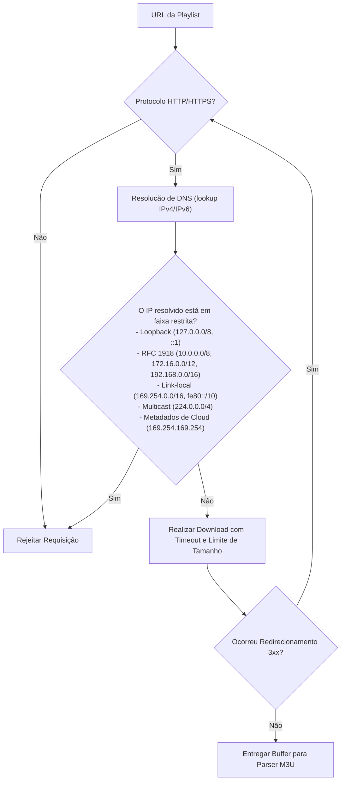

# Diretrizes de Segurança e Privacidade - IPTV Local

## 1. Princípios de Segurança e Isolamento

Este projeto opera sob o princípio de **Confiança Zero na Rede Local (Zero Trust LAN)** e **Privacidade Absoluta**:
- A rede local doméstica é tratada como ambiente não confiável (outros dispositivos conectados não devem ter acesso administrativo irrestrito ao servidor).
- Nenhuma informação (playlists, nomes de canais, histórico de visualização, tokens ou credenciais) é transmitida para fora da rede local. Não há analytics, telemetria ou chamadas a APIs em nuvem.

---

## 2. Pareamento TV ↔ Servidor via PIN Efêmero

Para garantir que apenas a TV física autorizada pelo proprietário possa consumir os canais e configurações do servidor:

1. **Geração do PIN:**
   - O usuário clica em "Parear Nova TV" no painel web (`apps/manager`).
   - O servidor gera um PIN numérico aleatório de 6 dígitos gerado via `crypto.randomInt`.
   - O PIN expira rigorosamente em **5 minutos** e é de uso único.
2. **Confirmação:**
   - O usuário digita o PIN exibido na tela da TV LG.
   - A TV envia uma requisição `POST /api/devices/pair/confirm` com o PIN e um identificador de hardware/instalação único gerado aleatoriamente (`deviceId`).
3. **Limite de Tentativas e Bloqueio:**
   - Máximo de 3 tentativas incorretas por endereço IP; após isso, o PIN é invalidado imediatamente e um bloqueio temporário (rate-limiting) é aplicado.
4. **Token de Dispositivo:**
   - Em caso de sucesso, o servidor emite um token de sessão opaco e aleatório de 256 bits, armazenado localmente na TV (`localStorage`/armazenamento do webOS).
   - O usuário pode visualizar todas as TVs pareadas no painel web e revogar o acesso a qualquer momento com um clique.

---

## 3. Mitigação Rigorosa de SSRF (Server-Side Request Forgery)

Ao permitir o download opcional de playlists via URL fornecida pelo usuário, há risco de SSRF contra serviços internos da rede ou instâncias de nuvem. As seguintes regras são impostas pelo validador do servidor:

- **Defesa contra DNS Rebinding:** O IP resolvido inicialmente é o mesmo IP ao qual o socket HTTP se conecta (ou validado novamente em cada salto).
- **Limites:**
  - Timeout máximo de download: 15 segundos.
  - Tamanho máximo do arquivo baixado: 25 MB (proteção contra esgotamento de memória).
  - Máximo de 3 redirecionamentos permitidos.

---

## 4. Sanitização e Proteção de Credenciais

Muitos provedores autorizados de IPTV embutem credenciais na própria URL (exemplo: `http://servidor.com:8080/live/usuario/senha/123.m3u8` ou query parameters `?token=XYZ&user=ABC`).

- **Sanitização de Logs:**
  - O servidor implementa uma função de máscara regex para qualquer log ou mensagem de erro:
    - Qualquer ocorrência no formato `http(s)://user:password@host` é substituída por `http(s)://***:***@host`.
    - Parâmetros como `password=`, `token=`, `key=`, `secret=`, `auth=` têm seus valores substituídos por `***REDACTED***`.
- **Armazenamento de Senhas:**
  - O painel web de gerenciamento é protegido por senha mestre definida no primeiro boot, armazenada com hash criptográfico seguro (Argon2id ou Scrypt/PBKDF2 nativo do Node.js).
  - Nunca são salvas senhas em texto puro.

---

## 5. Operação com a TV LG

- Nenhuma tentativa de root, exploração de vulnerabilidades ou jailbreak é executada.
- A comunicação com a TV é realizada estritamente pelas ferramentas oficiais do **webOS Developer Mode** (`ares-cli`) fornecidas pela LG Electronics.
- Antes de qualquer comando de instalação ou alteração de estado na TV, o comando completo e seus efeitos são apresentados ao usuário para confirmação expressa.
